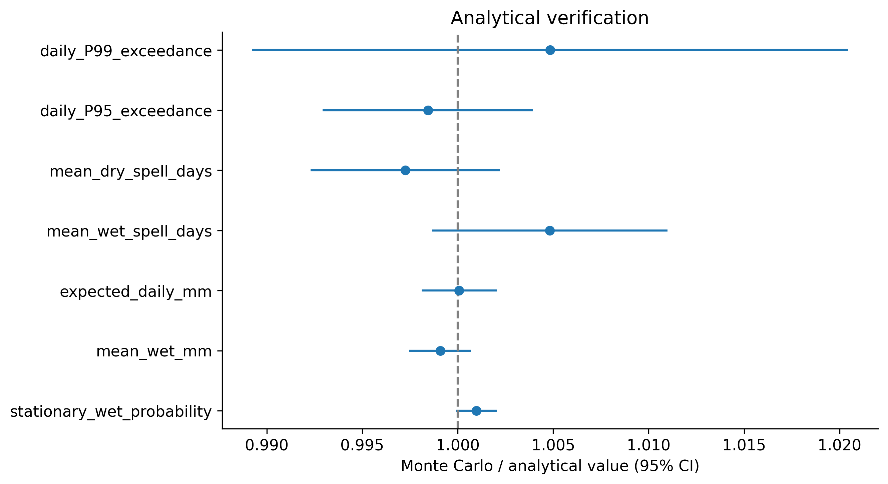
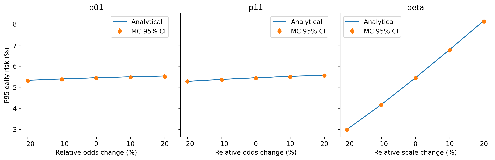

# Colombo Rainfall Simulator

A calibrated stochastic daily rainfall generator for exploring how rainfall occurrence, persistence and intensity influence extreme rainfall probability in Colombo, Sri Lanka.

**Live Web Simulator:** [Open the deployed dashboard](https://dilaraliyanage.github.io/colombo-rainfall-simulator/)

**Google Colab:** [Run the scientific notebook](https://colab.research.google.com/github/DilaraLiyanage/colombo-rainfall-simulator/blob/main/notebook/colombo-rainfall-simulator.ipynb)

**Source Repository:** [View the source code and scientific outputs](https://github.com/DilaraLiyanage/colombo-rainfall-simulator)


*Actual application capture: seasonal baseline, seed 42, 365 days beginning 2021-01-01. Captured during local-asset Chromium testing; not a screenshot of the deployed URL. The author subsequently reported successful independent local dashboard and live GitHub Pages acceptance tests.*

[Full dashboard](docs/screenshots/web-dashboard.png) · [Mobile layout](docs/screenshots/web-dashboard-mobile.png)

## The problem

**How do rainfall occurrence patterns and intensity influence the probability of extreme rainfall events in Colombo?**

Rainfall is intermittent, persistent and strongly right-skewed. Modelling wet/dry occurrence separately from the intensity on wet days allows these mechanisms to be investigated, including seasonal changes and prolonged spells. The simulator generates statistically plausible synthetic rainfall sequences; it does not predict weather on specific dates or estimate flood probability.

## Quick start

**Web:** open the deployed dashboard above, or download the repository and open `docs/index.html` directly. HTML, CSS, JavaScript and the generated scientific parameter asset are local; no backend, CDN, build step or API key is required.

**Notebook:** open the Google Colab link and select **Runtime → Run all**. The installation cell uses exact scientific pins, and C01 verifies installed and loaded versions. C02 retrieves and checks the raw snapshots. C03–C30 regenerate the full scientific pipeline, 32 scientific figures and the 72-entry output manifest. If a runtime preloads incompatible compiled packages, restart the session after installation and run all again rather than bypassing version assertions. The author reports successful independent Windows Python 3.14 and Google Colab execution of the frozen workflow.

**Local notebook (Windows PowerShell):** open the repository in VS Code, select the intended Python 3.14 kernel and run all cells from a fresh kernel. If needed, install the scientific pins and Jupyter kernel support first:

```powershell
python -m pip install -r requirements.txt
python -m pip install ipykernel
```

The notebook finds the repository root, reads local `data/raw/` and overwrites outputs under `data/processed/` and `figures/`. Explicit `RAINFALL_DATA_DIR` and `RAINFALL_OUTPUT_DIR` overrides support isolated regression tests. See [data instructions](data/README.md), [output manifest](data/processed/output_manifest.csv), [figure inventory](figures/README.md) and [execution guide](USER_GUIDE.md).

## Using the demo

Choose the homogeneous or seasonal model, start date, duration (1–3650 days), preceding day's state, seed and scenario. Start animates the trajectory; Pause/Resume preserve the generator state; Run instantly completes the remaining days; Reset clears results and unlocks settings. The three multipliers range from 0.8 to 1.2: odds for dry-to-wet and wet-to-wet transitions, scale for rainfall intensity. Odds changes are not percentage-point changes.

The daily and cumulative rainfall charts, occurrence timeline, extreme-event counts and statistics describe a single synthetic trajectory. The separate analytical risk table averages model probabilities over the same horizon and origin. The full [user guide](USER_GUIDE.md) includes the reproducible seed-42 example and verification procedure.

After deliberately regenerating the scientific notebook outputs, run `python generate_web_parameters.py` from the repository root to refresh `docs/model-parameters.js`. This standard-library utility converts the exported scientific JSON and benchmark CSVs; it does not refit the model or change the data. Never manually transcribe the calibrated values into JavaScript.

## Model and mathematics

The original Open-Meteo hourly precipitation is reconstructed into daily totals (2001–2025). Thresholds and model parameters use calibration dates 2001–2020 only; the 2021–2025 holdout is reserved for aggregate validation. A day is wet at rainfall $R\geq0.1$ mm; dry model rainfall is zero. Extreme events strictly exceed the fixed all-day calibration P95 (25.2 mm) or secondary P99 (46.296 mm).

The homogeneous occurrence model estimates $p_{ij}=\Pr(S_t=j\mid S_{t-1}=i)=n_{ij}/\sum_k n_{ik}$ from chronological wet/dry transitions. Wet-day amounts use a lower-truncated Gamma distribution, with exponential and log-normal alternatives compared using normalised likelihoods. The seasonal model selects the calibrated transition matrix and Gamma parameters by destination date and preserves state continuity across boundaries. For a threshold $u\geq0.1$ mm,

$$\Pr(R_t>u)=\Pr(S_t=1)\Pr(X_t>u\mid X_t\geq0.1).$$

The notebook uses inverse survival sampling; the browser uses Gamma rejection sampling to obtain the same conditional distribution without clipping. Full derivations, assumptions and numerical methods: [THEORY.md](THEORY.md).

## Verification

Implementation verification is distinct from validation against historical rainfall. The principal completed checks are:

| Check | Result | Evidence |
|---|---|---|
| Raw coverage, checksums, conservation and calibration invariants | Passed | [Data documentation](data/README.md) |
| Homogeneous deterministic tests and stationary analytical comparisons | 21/21 and 7/7 | [Tests](data/processed/simulation_verification.csv) · [Benchmarks](data/processed/monte_carlo_analytical.csv) |
| Convergence | RMSE slopes −0.573, −0.484, −0.471 for wet probability, daily rainfall and P95 risk | [Convergence](data/processed/convergence_slopes.csv) |
| Seasonal tests and time-dependent analytical comparisons | 20/20 and 4/4 | [Tests](data/processed/seasonal_verification.csv) · [Benchmarks](data/processed/seasonal_analytical.csv) |
| Browser deterministic and analytical/Monte Carlo parity | 16/16 and 11/11, including 29 shared-input sensitivity configurations | [JavaScript evidence](docs/web-verification-results.json) |
| Browser interaction and responsive layout | 14/14 in the original Chromium local-asset test; subsequent independent local and deployed acceptance reported by the author | [Browser evidence](docs/web-browser-test-results.json) |

The homogeneous analytical experiment uses 600 independent 3,650-day trajectories; seasonal verification uses 1,000 independent calendar-aligned 1,826-day trajectories. Acceptance is absolute error ≤ 4 trajectory-level Monte Carlo standard errors (MCSE) + 1e-9; deterministic mathematical calculations and cross-language analytical targets are checked separately. Individual JavaScript and NumPy random sequences need not be identical.



*F16: independent stationary mathematical expectations versus simulated estimates; the intervals measure Monte Carlo uncertainty conditional on the fitted model.*

The optional [read-only numerical verifier](verify_reproducibility.py) compares completed output roots against a frozen reference. It preserves exact historical and discrete invariants, metric-specific continuous tolerances and complete discrepancy reporting. See [comparison instructions and policy](USER_GUIDE.md#numerical-reproducibility-policy). In the readability regression, all 31 code-cell syntax trees and both Python utilities' syntax trees were preserved. A complete Linux Python 3.13.5 diagnostic notebook (using the available pandas 2.2.3, not the target 2.3.3) regenerated all 72 outputs with zero REVIEW/FAIL records; 69 files, including all 32 figures and their numerical data, were byte-identical. JavaScript original/revised comparisons and seed-42 trajectories were identical using the published parameter payload; desktop and mobile in-memory Chromium renderings were pixel-identical. These checks do not constitute a new Windows/Colab run or live deployment test of the readability revision.

## Concepts applied

- First-order discrete-time Markov chains, conditional probability and stationary/time-dependent probability propagation model occurrence.
- Truncated distribution likelihood, parameter estimation, inverse survival and rejection sampling model rainfall intensity.
- Independent pseudorandom streams, Monte Carlo replication, analytical benchmarks, confidence/prediction intervals and convergence tests quantify numerical uncertainty.
- Chronological holdout validation, common random numbers and controlled sensitivity distinguish model realism from implementation correctness and parameter effects.

## Results, limitations and future work

### Results

Gamma has the lowest AIC/BIC among the compared conditional intensity distributions, but underestimates the far tail. Under the stationary homogeneous model, analytical P95 probability is 5.4483% (Monte Carlo 5.4398%). Historical 2021–2025 P95 frequency is 8.1599%, outside the homogeneous 95% prediction interval of 4.4359–6.4622%. The predefined seasonal extension improves many aggregate diagnostics without refitting evaluation data:

| Diagnostic | Homogeneous | Seasonal | Historical / improvement |
|---|---:|---:|---|
| Monthly climatology RMSE (mm) | 126.53 | 73.48 | 41.93% lower |
| Seasonal mean daily rainfall RMSE (mm/day) | 4.091 | 1.510 | 63.08% lower |
| Overall daily P95 frequency | 5.434% | 5.141% | 8.160% observed |
| Mean simulated maximum complete wet spell (days) | 87.66 | 185.96 | 254 days observed |

See [comparative errors](data/processed/comparative_errors.csv), [holdout comparison](data/processed/comparative_holdout.csv) and [F26](figures/F26_comparative_monthly.png). The seasonal model better represents rainfall timing and prolonged spells, but overall P95 risk is slightly worse.



*F30: fixed-threshold sensitivity to occurrence odds, persistence odds and Gamma scale, with uncertainty across independent annual trajectories.*

The sensitivity experiment uses 500 annual trajectories per unique scenario, paired uniforms, five ±20% perturbation levels and the full persistence–intensity grid. Raising Gamma scale by 20% increases stationary analytical P95 risk from 5.4483% to 8.1660% (about 49.9% relative increase). Raising persistence odds by 20% increases it to 5.5721%, while extending the theoretical mean wet spell from 17.85 to 21.22 days. **Intensity is the dominant influence on marginal risk over the selected range; persistence matters for clustering.** See [sensitivity outputs](data/processed/sensitivity_scenarios.csv) and [F31](figures/F31_joint_sensitivity.png).

### Limitations and future work

- Reanalysis is not independent gauge truth. The acquisition URL relationship, underlying Best Match composition and hourly/daily accumulation discrepancy remain unresolved; see [provenance](data/README.md).
- First-order dependence and a single truncated Gamma cannot fully reproduce exceptional wet spells or heavy tails. Seasonal modelling improves climatology but not every risk diagnostic; higher-order dependence and alternative tail models would require separate evaluation.
- Confidence intervals estimate model-conditional expectations, prediction intervals describe synthetic trajectory variability, and neither automatically incorporates parameter, structural or reanalysis uncertainty. No holdout tuning is performed.
- Perturbations are mathematical sensitivity experiments, not climate projections or causal environmental interventions. Rainfall exceedance is not flood probability; drainage, terrain, exposure and antecedent moisture are absent. This is not an operational weather forecast.

## Key references

- R. D. Stern and R. Coe, “A model fitting analysis of daily rainfall data,” Journal of the Royal Statistical Society: Series A, vol. 147, no. 1, pp. 1–34, 1984. https://academic.oup.com/jrsssa/article/147/1/1/7106047
- S. Wilson Kemsley, T. J. Osborn, S. Dorling, C. Wallace, and J. Parker, “Selecting Markov chain orders for generating daily precipitation series across different Köppen climate regimes,” International Journal of Climatology, accepted manuscript, 2021. https://doi.org/10.1002/joc.7175
- H. G. Jin, S. Hong, and Y. Kim, “Synthetic rainfall modeling using a modified hybrid gamma-GP distribution,” Applied Sciences, vol. 15, art. 9563, 2025. https://doi.org/10.3390/app15179563
- A. Deoras, A. G. Turner, K. M. R. Hunt, and I. M. S. P. Jayawardena, “The influence of weather patterns and the Madden-Julian Oscillation on extreme precipitation over Sri Lanka,” Geophysical Research Letters, vol. 50, e2023GL103727, 2023. https://doi.org/10.1029/2023GL103727

Full list: [REFERENCES.md](REFERENCES.md).

## AI assistance

AI assisted with code and documentation, literature summaries, preprocessing, calibration, simulation and analytical checks, reproducibility tooling, dashboard implementation and readability refinement. The author directed scientific decisions and reports independent notebook, dashboard and deployment testing. Verification records distinguish observed execution evidence from outstanding platform checks; private evidence is maintained separately from this public repository.

## Licence and credits

Code: [MIT](LICENSE). Weather data: modified Open-Meteo precipitation snapshots, [CC BY 4.0 attribution](https://open-meteo.com/en/license). See [data provenance, upstream notices and redistribution details](data/README.md). Academic references are separate from dataset attribution.
