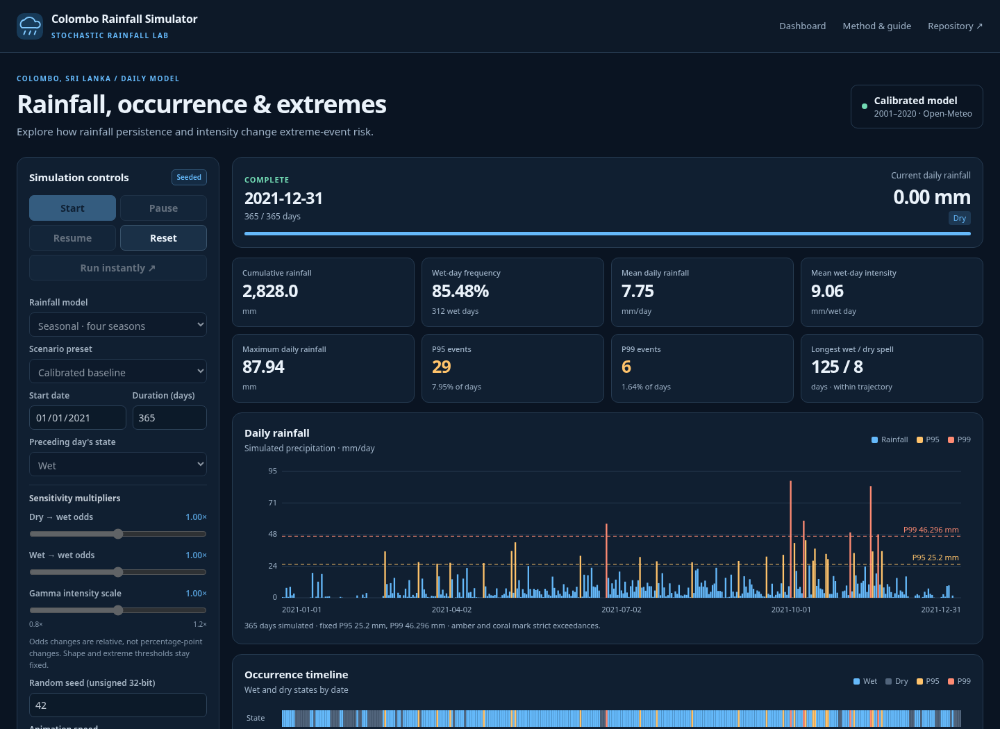

# Colombo Rainfall Simulator

A calibrated stochastic daily rainfall generator for exploring rainfall variability and persistence in Colombo, Sri Lanka.

[Live demo (deployment to be verified)](https://dilaraliyanage.github.io/colombo-rainfall-simulator/) · 

**Running interface:** seasonal baseline, seed 42, 365 days starting 2021-01-01. Actual Chromium capture from in-memory rendering of the local application assets; direct-file/Pages loading is pending independent verification.

[Full dashboard](docs/screenshots/web-dashboard.png) · [Mobile layout](docs/screenshots/web-dashboard-mobile.png)

## The problem

How do rainfall occurrence patterns and intensity influence the probability of extreme rainfall events in Colombo? Synthetic sequences may support exploratory risk analysis, but are not operational forecasts.

## Quick start

Open `docs/index.html` directly in a modern browser (no server, build, external assets or credentials). The browser uses the generated `docs/model-parameters.js` asset. The expected Pages URL is linked above; deployment from `main` / `/docs` must be verified independently.

Open the notebook using the badge after publication, then select Runtime → Run all. The notebook retrieves immutable snapshots from `data/raw/`, checks their SHA-256 values, reconstructs rainfall, calibrates all parameters, runs independent Monte Carlo verification and convergence experiments, evaluates the historical holdout, and regenerates all scientific outputs. No existing processed CSV, fitted parameters or figures are inputs. See [data instructions](data/README.md), [manifest](data/processed/output_manifest.csv) and [figure inventory](figures/README.md).

C01 checks exact scientific pins in `requirements.txt`, including actual imported module versions. The target environments are standard Windows Python 3.14 and Colab Python 3.13; the four pins are unchanged. Local execution searches parent directories for the repository root, reads `data/raw/` directly and writes outputs into the repository. Colab downloads both immutable public snapshots and checks their SHA-256 hashes. `RAINFALL_DATA_DIR` and `RAINFALL_OUTPUT_DIR` permit isolated offline tests. The first code cell uses standard Jupyter `%pip install` with the four exact pins; all scientific cells execute in the visible kernel. C01 checks installed and loaded versions, and stops on a mismatch. A fresh kernel is required; preloaded incompatible compiled packages may require a restart. No custom dispatch or worker is used. C01 invalidates the previous completion manifest and C30 creates it only after successful scientific execution. The notebook is distributed with cleared outputs. See [USER_GUIDE.md](USER_GUIDE.md) for independent execution and comparison instructions. The author reports successful Windows Python 3.14 execution with pandas 2.3.3 and all 72 outputs regenerated. Earlier numerical-equivalence and fresh Colab acceptance were pending at that stage; the available Linux diagnostic environment used pandas 2.2.3.

The previous homogeneous revision used two local notebook runs (direct and fresh worker), which completed in 50.13 s and 49.57 s including kernel startup; all 50 non-timing outputs were byte-identical. The two timing files differed as expected. Python 3.13.5 and the pinned scientific dependencies were used. See [runtime versions](data/processed/runtime_versions.csv) and [execution runtime](data/processed/execution_runtime.csv). 

Conventional notebook revision: the installation cell uses `%pip` followed by C01 imports and exact installed/loaded version checks; C02–C30 are source-identical to the previous scientific cells after removing the dispatch prefix. A Linux Python 3.13.5 diagnostic copy using the available pandas 2.2.3 completed all 31 code cells in 69.82 s including installation and kernel startup. It regenerated all 72 outputs and displayed all 32 figures. The existing metric-aware verifier accepted the outputs with zero REVIEW or FAIL records; 69 files were byte-identical to the reference and only three timing files differed. The delivered notebook retains pandas 2.3.3: its exact-pin test stopped at C01 because the configured package index did not provide that version. Those diagnostics did not verify Windows or Colab; the author has subsequently reported successful local and Colab notebook execution. A Colab runtime with already-imported incompatible packages may require one session restart; automatic no-intervention execution has not been established.

## Using the demo

Select homogeneous or seasonal, set a start date, duration (1–3650 days), preceding state, seed and scenario. Start animates; Pause/Resume preserve the state; Run instantly completes the remaining days. Reset clears the trajectory and unlocks parameters. The three sensitivity multipliers are 0.8–1.2 (odds for transitions, scale for intensity). The same JavaScript seed and configuration reproduce the trajectory. Analytical risk is horizon-averaged conditional on the chosen origin, not a single-trajectory frequency. See [USER_GUIDE.md](USER_GUIDE.md).

After a scientific notebook run, regenerate the browser asset from the frozen model JSON and verification CSVs using `python generate_web_parameters.py` from the repository root. This standard-library conversion does not recalibrate or modify scientific outputs.

## Model and mathematics

The calibrated homogeneous first-order occurrence model uses $P_{ij}=P(S_t=j\mid S_{t-1}=i)$ for dry/wet states, followed by conditional sampling of wet-day amounts. Wet amounts use a lower-truncated Gamma baseline (shape 0.708847, scale 11.343819 mm); exponential and log-normal alternatives were compared. The seasonal generator selects the four calibrated transition matrices and truncated Gamma fits by destination date, retaining state continuity. See [THEORY.md](THEORY.md).

## Verification

The browser implementation passed 16 deterministic scientific checks (including 29 unique frozen sensitivity fixtures) and 11 analytical/Monte Carlo comparisons: 600 stationary homogeneous trajectories × 3,650 days and 1,000 calendar-dependent seasonal trajectories × 1,826 days. All use seed 42 with distinct seeded streams. Acceptance: absolute error ≤ 4 MCSE + 1e-9 using independent trajectory units; JavaScript analytical expectations separately agree with Python to atol=1e-9 plus rtol=1e-8. The largest analytical discrepancy was 3.31e-13. See [JavaScript evidence](docs/web-verification-results.json) and [Chromium interaction evidence](docs/web-browser-test-results.json). Chromium in-memory rendering passed 14 checks including both models, pause/resume, repeatability, reset, preset, leap day and mobile width; no uncaught JS errors. Managed browser policy blocked file:// and localhost navigation, so direct-file asset loading and deployed Pages remain independently unverified. Screenshots are actual local-asset renders, not deployment captures. No Node.js or test framework is required to run the dashboard.

Preprocessing, calibration and quadrature assertions passed. All 21 deterministic/domain/reproducibility checks passed, and all seven stationary analytical benchmarks passed the four-MCSE tolerance using 600 independent 3,650-day trajectories. See [simulation checks](data/processed/simulation_verification.csv), [analytical comparisons](data/processed/monte_carlo_analytical.csv), [F16](figures/F16_analytical_verification.png) and [F17](figures/F17_convergence.png). Twenty independent batches at each of six replication counts yielded log-log RMSE slopes of −0.573 (wet probability), −0.484 (mean rainfall) and −0.471 (P95 exceedance). This verifies the numerical implementation, not the real-world adequacy of the model. The previous homogeneous revision was independently executed in Colab, as reported by its author. Subsequent local and Colab execution of the frozen scientific notebook has been reported by its author; this web update does not rerun or change it.

## Concepts applied

Concepts: stochastic processes for occurrence, conditional probability for transitions, random variate generation for amounts, Monte Carlo replication for uncertainty, parameter estimation and statistical model verification.

## Results, limitations and future work

The Gamma baseline gives the lowest AIC/BIC among the compared wet-day distributions, but underestimates the far upper tail. The stationary analytical P95 risk is 5.4483%; the Monte Carlo estimate is 5.4398%. The independent 2021–2025 holdout ensemble (1,000 five-year trajectories, initialised from the final calibration state) estimates P95 frequency at 5.4338% versus 8.1599% historically, outside the 95% prediction interval of 4.4359–6.4622%. Historical mean daily rainfall and wet frequency also exceed their simulated intervals. The historical maximum complete wet spell is 254 days versus a simulated 95% interval of 56–142 days. Seasonal means and risks are not reproduced by the homogeneous model; no holdout values were used to refit parameters. See [holdout comparisons](data/processed/holdout_comparison.csv), [F20](figures/F20_monthly_holdout.png) and [F23](figures/F23_holdout_intervals.png).

The model separates occurrence from conditional intensity: $P(R>u)=\pi_1P(X>u\mid S=1)$. Dependence affects clustering, and Gamma parameters affect wet-day tail risk. This is a marginal-risk decomposition, not a causal finding. Prediction intervals describe trajectory variability; confidence intervals quantify Monte Carlo uncertainty conditional on fitted parameters. Reanalysis, parameter and structural uncertainty are not included. The 0.1 mm wet threshold, calibration all-day P95/P99, calibration/evaluation split and midnight correction remain unchanged. Best Match provenance and the aggregation discrepancy are unresolved. This simulator is neither a deterministic weather forecast nor a flood prediction system. The seasonal simulation and controlled sensitivity analysis are implemented. The interactive browser simulator implements these frozen models; no new fit or model extension is introduced.

The seasonal comparison uses the same 1,000 five-year trajectories, calendar, preceding state and paired random draws. Monthly RMSE falls from 126.53 to 73.48 mm (41.93%); seasonal daily mean RMSE falls from 4.091 to 1.510 mm/day (63.08%). All four time-dependent analytical benchmarks pass. The seasonal overall P95 probability is 5.141% versus 8.160% historically (worse than homogeneous 5.434%); maximum complete wet spell improves from mean 87.66 to 185.96 days, versus historical 254 days. See [comparative results](data/processed/comparative_holdout.csv) and [verification](data/processed/seasonal_analytical.csv).

Sensitivity uses 500 independent annual trajectories per unique scenario, with paired uniforms, ±20% odds or scale perturbations and the full persistence–intensity grid. Gamma scale +20% raises analytical P95 risk from 5.4483% to 8.1660%; persistence +20% raises it to 5.5721% but increases expected wet-spell duration from 17.85 to 21.22 days. This is model sensitivity, not a climate projection or causal finding. See [scenario results](data/processed/sensitivity_scenarios.csv), [figure inventory](figures/README.md) and [manifest](data/processed/output_manifest.csv).

Two independent local processes ran every scientific source cell in sequence using the previous installed pandas pin, without the notebook bootstrap (57.51 s and 58.25 s). All 69 non-timing outputs, including 32 PNGs and numerical figure data, were byte-identical. The original local scientific-source regression was byte-identical under the previous dependency pins. The read-only [comparison utility](verify_reproducibility.py) now distinguishes exact invariants, strict numerical metrics, fitted continuous parameters, derived quantities, optimisation diagnostics and discrete changes requiring review. It writes complete discrepancy and grouped metric reports outside both compared roots. See [the verification policy](USER_GUIDE.md#numerical-reproducibility-policy).

Compatibility diagnostic: two complete cleared-output notebook runs (including bootstrap and cell dispatch) finished in 64.54 s (direct) and 68.93 s (worker) on Linux Python 3.13.5 using a separately modified diagnostic copy pinned to the available pandas 2.2.3. Both regenerated all 72 outputs; 69 matched the supplied S006 reference byte-for-byte and only three timing files differed. Numerical comparisons passed. The delivered notebook retains pandas 2.3.3; its actual execution stopped in C01 at package installation because the package index was unavailable. The author subsequently reported successful Windows execution under the target pins. Those earlier checks were pending at the time; the author now reports successful local and Colab notebook execution.

Cross-platform comparison policy: the supplied homogeneous Gamma fit from Windows differs from the reference by approximately 3.41e-8 (shape) and 5.94e-8 (scale) in relative terms, with effectively unchanged log-likelihood. These observations support a candidate 1e-6 fitted-parameter relative tolerance. All historical values, counts, configurations and classification labels remain exact. Changed simulated event/state counts require investigation and block acceptance. Continuous derived tolerances and diagnostic quality screening are documented in the user guide. This update changes verification tooling only, not the notebook, calibration, simulations or scientific outputs. The revised comparator was tested on reference copies and deliberate corruption fixtures; the author subsequently reported Windows comparison results and a targeted analytical baseline residual correction. The web update leaves that utility unchanged.

## Key references

- R. D. Stern and R. Coe, “A model fitting analysis of daily rainfall data,” Journal of the Royal Statistical Society: Series A, vol. 147, no. 1, pp. 1–34, 1984. https://academic.oup.com/jrsssa/article/147/1/1/7106047
- S. Wilson Kemsley, T. J. Osborn, S. Dorling, C. Wallace, and J. Parker, “Selecting Markov chain orders for generating daily precipitation series across different Köppen climate regimes,” International Journal of Climatology, accepted manuscript, 2021. https://doi.org/10.1002/joc.7175
- H. G. Jin, S. Hong, and Y. Kim, “Synthetic rainfall modeling using a modified hybrid gamma-GP distribution,” Applied Sciences, vol. 15, art. 9563, 2025. https://doi.org/10.3390/app15179563
- A. Deoras, A. G. Turner, K. M. R. Hunt, and I. M. S. P. Jayawardena, “The influence of weather patterns and the Madden-Julian Oscillation on extreme precipitation over Sri Lanka,” Geophysical Research Letters, vol. 50, e2023GL103727, 2023. https://doi.org/10.1029/2023GL103727

Full list: [REFERENCES.md](REFERENCES.md).

## AI assistance

AI assisted with cross-platform bootstrap and regression tooling, the initial scaffold, literature summaries, preprocessing, exploratory analysis, path corrections, calibration, likelihood diagnostics, analytical checks, homogeneous simulation, convergence, holdout evaluation dependency bootstrap corrections, seasonal simulation and sensitivity analysis. AI also assisted with the web dashboard, generated parameter asset and JavaScript verification. Author review and independent web execution/deployment verification remain pending.

## Licence and credits

Code: [MIT](LICENSE). Dataset attribution and redistribution status: [data/README.md](data/README.md). Weather data are separately licensed under CC BY 4.0; see source credits and provenance limitations before redistribution.
